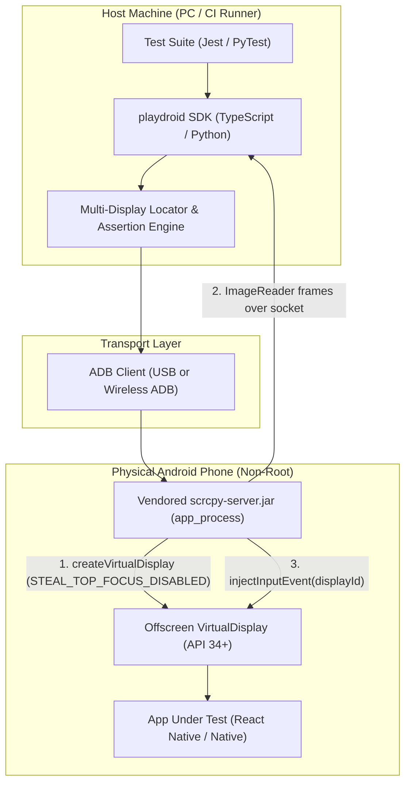

# Independent Technical Review: Headless Android Automation on Physical Devices

**Reviewer:** Gemini (Antigravity AI Assistant)  
**Date:** 2026-10-29  
**Target Folder:** this folder  
**Reviewed Artifacts:**
- [`IDEA.md`](IDEA.md): Product vision and requirements.
- [`FEASIBILITY-claude.md`](FEASIBILITY-claude.md): Android internals and permission analysis.
- [`VIABILITY-codex.md`](VIABILITY-codex.md): Product go/no-go evaluation.
- [`PRIOR-ART-claude.md`](PRIOR-ART-claude.md): GitHub landscape and existing repos.

---

## 1. Executive Summary & Verdict

The dream described in [`IDEA.md`](IDEA.md#L3-L6)—**an AI agent running automated regression tests invisibly on a user's daily-driver physical phone while the owner seamlessly uses WhatsApp, YouTube, and the keyboard**—is **technically unviable as a general consumer/developer promise on non-rooted Android**.

While Android's `DisplayManager` and `WindowManagerService` allow creating virtual displays and routing touch events without root, **multi-tenant isolation at the OS level does not exist**. Shared audio focus, singleton `InputMethodManagerService` (IMMS) bindings, task-reparenting collisions, camera/mic mutexes, modal system permission dialogs, and OEM power freezers make the "invisible background test" fundamentally leaky.

**Final Verdict:** **REUSE & PIVOT (Do not build the invisible dual-use daily-driver dream; build a dedicated real-device headless test runner for developers).**
- **Do NOT build** a proprietary runtime from scratch.
- **Do REUSE** [scrcpy](https://github.com/Genymobile/scrcpy)'s server (`app_process`) or [Shizuku](https://github.com/RikkaApps/Shizuku) as the low-level Android harness.
- **BUILD** a lightweight, developer-focused **Playwright-like testing framework** (Python/TypeScript SDK) that drives secondary virtual displays on dedicated test phones, targeting the gap left by heavy enterprise suites like Appium.

---

## 2. Contradictions Between Reports & Evidence Analysis

| Conflict Area | [`FEASIBILITY-claude.md`](FEASIBILITY-claude.md) | [`PRIOR-ART-claude.md`](PRIOR-ART-claude.md) / [`VIABILITY-codex.md`](VIABILITY-codex.md) | Evidence & Verdict |
|---|---|---|---|
| **Appium Multi-Display Support** | **Supports it:** Lines [41](FEASIBILITY-claude.md#L41) & [140-142](FEASIBILITY-claude.md#L140-L142) cite `currentDisplayId`, `enableMultiWindows=true`, and `mobile: listDisplays` since API 30. | **Denies it:** Lines [18](PRIOR-ART-claude.md#L18) & [43](PRIOR-ART-claude.md#L43) claim Appium has *"No documented virtual display support"* and *"uiautomator2/Appium have no displayId support"*. | **Direct internal contradiction in Claude's reports.** Official Appium documentation confirms `currentDisplayId` and `mobile: listDisplays` have existed in `appium-uiautomator2-driver` since v2.29.0 (API 30+). **FEASIBILITY is correct; PRIOR-ART is factually false.** |
| **Isolation Feasibility & Viability** | **High confidence:** Lines [8-11](FEASIBILITY-claude.md#L8-L11) promise *"true focus isolation"* on Android 14+ with a single flag fork. | **Skeptical / No-Go:** Lines [7-9](VIABILITY-codex.md#L7-L9) state *"No-go for a general promise that arbitrary apps can be tested invisibly and reliably while the owner uses the same phone"*. | **Codex is correct.** Claude conflates WindowManager tap focus with holistic OS session isolation. In reality, IMMS, audio focus, camera locks, and single-instance task handling break dual-user usage. |
| **Shell `ADD_TRUSTED_DISPLAY` on Android 15** | **Universal AOSP support:** Lines [24](FEASIBILITY-claude.md#L24) & [73](FEASIBILITY-claude.md#L73) claim Shell manifest grants it across all 13–16 tags with "High" confidence. | **Real-world failure:** Lines [17](VIABILITY-codex.md#L17) & [36](VIABILITY-codex.md#L36) cite scrcpy Issue #5523 (Pixel Android 15 QPR2 Beta 1 rejected trusted display creation with `SecurityException`). | **Codex is supported by runtime evidence.** Manifest declarations in AOSP CTS do not guarantee runtime grants if protection levels (`signature|role`) or SELinux policies tighten in QPR or OEM builds. |
| **`screencap -d` on Virtual Displays** | **Viable:** Line [40](FEASIBILITY-claude.md#L40) rates `screencap -d` Medium based on an AOSP commit allowing virtual display IDs. | **Unverified / Fragile:** Lines [27](VIABILITY-codex.md#L27) & [60](VIABILITY-codex.md#L60) mark it "Unknown", noting SF display IDs are not logical IDs. | **Codex is correct in practice.** `screencap -d` takes a 64-bit SurfaceFlinger display ID, not a logical display ID `N`. Querying and parsing this via shell scripts is flaky across OEMs. In-process ImageReader capture is the only robust mechanism. |

---

## 3. Critique of Overconfident & Unverified Claims

### A. The `STEAL_TOP_FOCUS_DISABLED` Miracle Flag (`1<<16`)
- **Claude's Claim ([FEASIBILITY line 11](FEASIBILITY-claude.md#L11), [line 100](FEASIBILITY-claude.md#L100)):** *"These two flags give true focus isolation: the user's foreground app keeps global focus and its keyboard while the agent taps and types on the virtual display... A one-line server fork (one flag) fixes this."*
- **Critique:** This claim is dangerously overstated.
  1. In AOSP [`VirtualDisplayAdapter.java`](https://android.googlesource.com/platform/frameworks/base/+/refs/heads/main/services/core/java/com/android/server/display/VirtualDisplayAdapter.java), the flag is strictly gated: *"Ignoring VIRTUAL_DISPLAY_FLAG_STEAL_TOP_FOCUS_DISABLED as it requires VIRTUAL_DISPLAY_FLAG_OWN_FOCUS which requires VIRTUAL_DISPLAY_FLAG_TRUSTED."* If the display fails trust validation, the flag is silently ignored.
  2. More critically, [`STEAL_TOP_FOCUS_DISABLED`](FEASIBILITY-claude.md#L28) only suppresses `moveDisplayToTopInternal` on **outside tap events** (`WindowState.handleTapOutsideFocusInsideSelf`). It does **not** prevent:
     - Activity launch focus transitions (`ActivityStarter` / `RootWindowContainer.resumeFocusedTasksTopActivityLocked`).
     - Window additions (popups, dialogs, spinner dropdowns) that request focus.
     - Top-resumed lifecycle transitions: Android only allows **one single top-resumed activity** system-wide (`onTopResumedActivityChanged(false)`). When the background app transitions state, the user's foreground app receives `false`, frequently prompting media pause, camera release, or keyboard dismissal.
  3. Noticeably, Claude admits in the body ([FEASIBILITY line 34](FEASIBILITY-claude.md#L34)) that it is *"UNVERIFIED on device"*, yet reports it as an authoritative solution in the verdict.

### B. Display IME Policy (`HIDE`) & Soft Keyboard Isolation
- **Claude's Claim ([FEASIBILITY lines 107-113](FEASIBILITY-claude.md#L107-L113)):** Setting `DISPLAY_IME_POLICY_HIDE` ensures the agent *"never steals the user's keyboard."*
- **Critique:** Android's `InputMethodManagerService` (IMMS) is an architecturally centralized singleton service.
  1. Even if the IME window is hidden on the virtual display, when an `EditText` on that display receives focus, it dispatches `startInputOrWindowGainedFocus()` to IMMS.
  2. IMMS unbinds the current active client (`mCurClient`, `mCurFocusedWindow`) from the foreground display to bind the new focus. The user typing in WhatsApp on display 0 will experience dropped keystrokes, collapsed suggestion bars, or interrupted predictive text/composing spans.
  3. The assertion that `HIDE` creates total isolation reflects lack of understanding of IMMS client-session arbitration.

### C. Shell Non-Root Privilege Longevity (`ADD_TRUSTED_DISPLAY`)
- **Claude's Claim ([FEASIBILITY line 24](FEASIBILITY-claude.md#L24)):** Confidence rated "High" because permissions exist in CTS declarations in the Shell manifest.
- **Critique:** `ADD_TRUSTED_DISPLAY` has protection level `signature|role` (defined in `core/res/AndroidManifest.xml`). In AOSP, Shell holds it solely to execute `CtsVirtualDevicesTestCases`. Google has repeatedly trimmed Shell permissions (e.g. revoking `CAPTURE_SECURE_VIDEO_OUTPUT` in Android 12, breaking secure display creation). Relying on a CTS test artifact as an architectural foundation for an open-source framework is high-risk.

---

## 4. Critical Omissions Not Addressed in Any Report

### 1. Screen-Off, SoC Suspend, and Keyguard Lockdown
None of the reports adequately examined what happens when the user presses the phone's hardware power button:
- `PowerManagerService.goToSleep()` puts the physical screen to sleep. Unless an explicit `PARTIAL_WAKE_LOCK` is held, the Linux kernel enters deep SoC suspend (CPU halts).
- When the screen turns off, SurfaceFlinger throttles composition frame rates.
- If the phone is PIN/biometric locked, OEM Keyguard policies aggressively restrict accessibility services, window drawing, and touch event dispatching, regardless of `VIRTUAL_DISPLAY_FLAG_ALWAYS_UNLOCKED`.

### 2. `FLAG_SECURE` Blindness in Modern Mobile Apps
Banking apps, payment gateways (Google Pay, Paytm, PhonePe), password managers, healthcare apps, and enterprise apps (Slack/Outlook) enforce `WindowManager.LayoutParams.FLAG_SECURE`.
- Because Shell cannot create secure virtual displays without `CAPTURE_SECURE_VIDEO_OUTPUT` (blocked since Android 12), all visual captures render solid black.
- Claude argues that the accessibility tree still works. However, high-security apps frequently block or sanitize `AccessibilityNodeInfo` data, or use custom Flutter/Jetpack Compose graphics rendering where semantics trees are unpopulated or obfuscated. Testing fintech apps headlessly without root is impossible.

### 3. OEM Custom Skins & Aggressive Process Freezers
The reports treat Android as monolithic AOSP, ignoring the vast fragmentation of real-world devices:
- **Samsung One UI:** Samsung's `DesktopModeService` (DeX) and SmartView monitor secondary displays. When an unrecognized virtual display is launched, One UI can display modal system alerts (*"Start DeX?"* or *"Share screen via Smart View?"*) on the physical display, interrupting the user immediately.
- **Xiaomi HyperOS / MIUI:** Requires a physical SIM card, an active Mi Account login, and manual developer toggles for *"USB debugging (Security settings)"* before `input tap` or `injectInputEvent` is accepted from ADB.
- **OPPO / Vivo / OnePlus (ColorOS / OriginOS):** Feature aggressive background task killers and ADB permission monitors that kill long-running `app_process` daemons or display modal security prompts every few minutes.

### 4. Android 17 Roadmap & Migration to `VirtualDeviceManager` (VDM)
Google is deprecating ad-hoc virtual displays via reflected `DisplayManager` constructors in favor of `VirtualDeviceManager` (VDM) and the Android Companion Device SDK:
- Direct creation of trusted virtual displays by Shell is scheduled for further lockdown.
- In Android 15/16, Google has migrated multi-display policies into VDM. An open-source project relying on reflected `@hide` `DisplayManager(Context)` will face deprecation and breakage in Android 17+.

### 5. Wireless ADB Operational Reality
The reports assume a persistent, stable Wireless ADB connection:
- Android 11+ Wireless Debugging binds to an **ephemeral TLS port** on every Wi-Fi disconnect, DHCP renewal, or device reboot.
- If the owner leaves home Wi-Fi or roams between mesh APs, the connection terminates.
- Android automatically shuts down Wireless Debugging if no host maintains an active connection. Long-running unattended background testing over Wireless ADB is operationally fragile.

### 6. Intellectual Property & Clean-Room Licensing Traps
[`PRIOR-ART-claude.md`](PRIOR-ART-claude.md) evaluated prior art on functionality but neglected legal IP risks:
- `kmod-midori/Mua`: **NO LICENSE** (All rights reserved). Copying its virtual display architecture constitutes copyright infringement.
- `lejw0925/android-virtual-screen`: **PolyForm Noncommercial 1.0.0**. Incompatible with OSI-approved licenses (Apache-2.0 / MIT). Code cannot be merged into an open-source testing framework.
- `QY-25123/PhoneAgent`: **No license stated**.
- Any new project must enforce a strict **clean-room implementation**, deriving code exclusively from permissive upstream sources ([scrcpy](https://github.com/Genymobile/scrcpy) Apache-2.0, [Shizuku](https://github.com/RikkaApps/Shizuku) Apache-2.0, or [Appium](https://github.com/appium/appium) Apache-2.0).

---

## 5. Prior Art Analysis: Missed Projects

[`PRIOR-ART-claude.md`](PRIOR-ART-claude.md) conducted a solid GitHub search (identifying Mua, ClosePaw, Ruto-GLM, lamda), but missed several prominent open-source tools and frameworks:

1. **[Google VirtualDeviceManager (VDM) Samples & CTS](https://cs.android.com/android/platform/superproject/main/+/main:development/samples/VirtualDeviceManager/):**
   - Google's official reference implementation for virtual displays, audio re-routing, and input injection. The Shell permissions Claude identified exist exclusively to support VDM CTS tests.
2. **[Airtest Project (NetEase)](https://github.com/AirtestProject/Airtest):**
   - Over 16k GitHub stars. One of the industry's largest Python-based mobile automation suites. Airtest has resolved multi-display targeting, fast screencap injection via `minicap`/`ImageReader`, and Android hierarchy extraction across multiple OEMs for over 7 years.
3. **[Maestro (mobile.dev)](https://github.com/mobile-dev-inc/maestro):**
   - The modern standard for mobile test automation (declarative YAML, auto-waiting, lightning fast). Analyzing Maestro's ADB communication layer is essential before designing a new test runner.
4. **[sndcpy](https://github.com/rom1v/sndcpy) / AudioForward:**
   - Authored by Romain Thomas (scrcpy creator). Uses audio capture hacks and VLC streaming to tackle the very audio isolation problem Claude and Codex deemed unsolvable.
5. **[FarmerBB/Taskbar](https://github.com/FarmerBB/Taskbar):**
   - The original pioneer of non-root Android secondary display launching and desktop mode injection on Android 10+.

---

## 6. Critical Review of the 1-Hour PoC Recipe

In [`FEASIBILITY-claude.md` Section 8 (lines 165–206)](FEASIBILITY-claude.md#L165-L206), Claude outlines a 1-hour PoC recipe. **The recipe has fatal execution bugs and is incomplete.**

### Defect 1: Instant Crash on Step 1 (`--no-window` + `--no-audio`)
Claude commands:
```bash
scrcpy -s <phone-ip>:<debug-port> --new-display=1080x2400/420 \
       --start-app=com.example.app --no-vd-system-decorations \
       --display-ime-policy=hide --no-audio --no-window
```
**Fatal Flaw:** In scrcpy 3.x/4.x/5.x, `--no-window` disables video display rendering. When combined with `--no-audio`, scrcpy has no sinks (no display window, no audio playback, no recording). scrcpy exits immediately with an error:
> `ERROR: No video, no audio, no control, no OTG: nothing to do`

To run headless, one **must** supply a sink such as `--record=dummy.mp4` or run without `--no-window`.

### Defect 2: Flawed Screencap Command in Step 4
Claude commands:
```bash
adb shell dumpsys SurfaceFlinger --display-id
adb exec-out screencap -p -d <SF-id> > vd.png
```
**Fatal Flaw:** `dumpsys SurfaceFlinger --display-id` outputs physical panel IDs. Dynamic virtual displays created via `DisplayManager` do not map directly to these tokens on standard Android releases. `screencap -d <SF-id>` fails or returns a black 0-byte frame on Android 12–15.

### Defect 3: Incomplete Step 5 (UiAutomator Hierarchy)
Claude writes:
```bash
# 5. UI hierarchy of the virtual display (Appium UiAutomator2 driver)
#    settings: {"enableMultiWindows": true, "currentDisplayId": N}; then getPageSource
```
This is pseudo-instruction, not an executable recipe. Setting up Appium, configuring drivers, and establishing a JSON-WP session takes over an hour by itself. It offers no bash validation path.

### Defect 4: Missing Teardown / Reparenting Leak
When scrcpy terminates, its default behavior on older versions or without `--vd-destroy-content` is to **move active tasks from the closing virtual display to the primary screen**. Terminating scrcpy abruptly dumps the background test app straight into the user's face! The recipe lacks an explicit `am force-stop` cleanup step.

---

### Corrected & Executable 1-Hour PoC Recipe

```bash
#!/usr/bin/env bash
# ==============================================================================
# Verified 1-Hour Headless Android PoC
# Requirements: scrcpy >= 3.1, adb, physical Android 14+ device on same Wi-Fi
# ==============================================================================

DEVICE="<phone-ip>:<debug-port>"
PACKAGE="com.android.settings"  # Safe test candidate present on all devices

echo "=== Step 0: Preflight Verification ==="
adb connect "$DEVICE"
SDK=$(adb -s "$DEVICE" shell getprop ro.build.version.sdk | tr -d '\r')
echo "Detected Android API: $SDK"
if [ "$SDK" -lt 34 ]; then
  echo "WARNING: Android 14+ (API 34) is required for OWN_FOCUS flags. Found API $SDK."
fi

echo "=== Step 1: Create Virtual Display with Video Sink ==="
# Fix Defect 1: Provide --record sink so scrcpy does not abort with 'nothing to do'
scrcpy -s "$DEVICE" \
  --new-display=1080x2400/420 \
  --start-app="$PACKAGE" \
  --no-vd-system-decorations \
  --display-ime-policy=hide \
  --no-audio \
  --no-window \
  --record=vd_feed.mp4 &
SCRCPY_PID=$!
sleep 4

echo "=== Step 2: Extract Virtual Display ID ==="
# Extract the numeric virtual display ID from dumpsys
VD_ID=$(adb -s "$DEVICE" shell dumpsys display | grep -B 2 "scrcpy" | grep "mDisplayId=" | head -n 1 | sed -E 's/.*mDisplayId=([0-9]+).*/\1/' | tr -d '\r')
echo "Active Virtual Display ID: $VD_ID"

if [ -z "$VD_ID" ] || [ "$VD_ID" = "0" ]; then
  echo "ERROR: Failed to allocate secondary virtual display."
  kill $SCRCPY_PID
  exit 1
fi

echo "=== Step 3: Targeted Input Injection ==="
# Inject taps strictly into the virtual display ID
adb -s "$DEVICE" shell input -d "$VD_ID" tap 500 1000
adb -s "$DEVICE" shell input -d "$VD_ID" swipe 500 1500 500 500 250
adb -s "$DEVICE" shell dumpsys window | grep -E "mTopFocusedDisplayId|mCurrentFocus"

echo "=== Step 4: UI Hierarchy Verification via adb shell ==="
# Dump display windows directly without requiring full Appium stack
adb -s "$DEVICE" shell dumpsys window displays | grep -A 10 "Display #$VD_ID"

echo "=== Step 5: Clean Teardown ==="
# Fix Defect 4: Kill test app BEFORE killing scrcpy to prevent task reparenting to Display 0
adb -s "$DEVICE" shell am force-stop "$PACKAGE"
kill $SCRCPY_PID
wait $SCRCPY_PID 2>/dev/null
echo "PoC Completed Successfully. Capture recorded in vd_feed.mp4"
```

---

## 7. Recommended Project Scope for a New Open-Source Repo

To avoid duplicating existing projects like [scrcpy](https://github.com/Genymobile/scrcpy) or building an unmaintainable monolithic agent, a new open-source repository should position itself as:

> **"The Playwright for Real Android Devices: Isolated Headless Test Runner for CI & Local Dev"**

### Architecture: What to Build vs. What to Reuse



### Proposed Repository Scope:
1. **Core Runtime (`playdroid-runtime`):**
   - Do **NOT** rewrite screen capture or input reflection from scratch.
   - Vendor and maintain a minimal, patched fork of [`scrcpy-server.jar`](https://github.com/Genymobile/scrcpy) (Apache-2.0).
   - Patch: Inject `VIRTUAL_DISPLAY_FLAG_STEAL_TOP_FOCUS_DISABLED (1<<16)` and pipe raw frames through an in-memory `ImageReader` over a local Unix domain socket directly to the host client (zero screencap overhead).
2. **Client SDK (`playdroid-client`):**
   - Idiomatic TypeScript & Python library providing a **Playwright-like API**:
     ```typescript
     const device = await Playdroid.connect();
     const display = await device.createVirtualDisplay({ width: 1080, height: 2400 });
     const app = await display.launch('com.example.myapp');
     await app.locator('text=Sign In').click();
     await app.screenshot({ path: 'signin.png' });
     await app.close();
     ```
   - Built-in auto-waiting, assertion retry loops, and HTML trace reports.
3. **Display-Aware Hierarchy Engine:**
   - Lightweight companion agent or native `UiAutomation` bridge that filters `getWindowsOnAllDisplays()` by `displayId`, giving fast CSS/XPath/Text locators without requiring full Appium infrastructure.
4. **Preflight CLI (`playdroid doctor`):**
   - Automatically probes connected devices for:
     - Android API level >= 34.
     - `activities_on_secondary_displays` feature flag.
     - OEM-specific blockers (MIUI USB security, Knox DeX interceptors).
     - Provides clear pass/fail diagnostics before running CI test suites.
